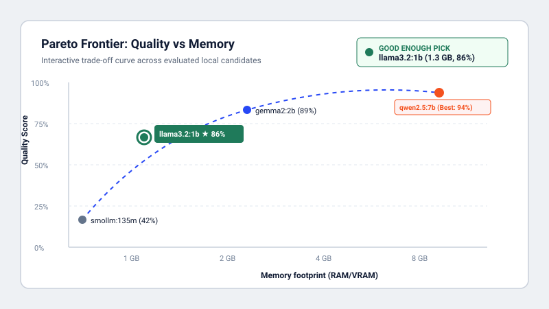
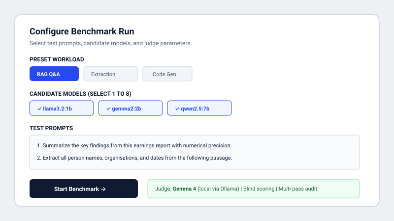
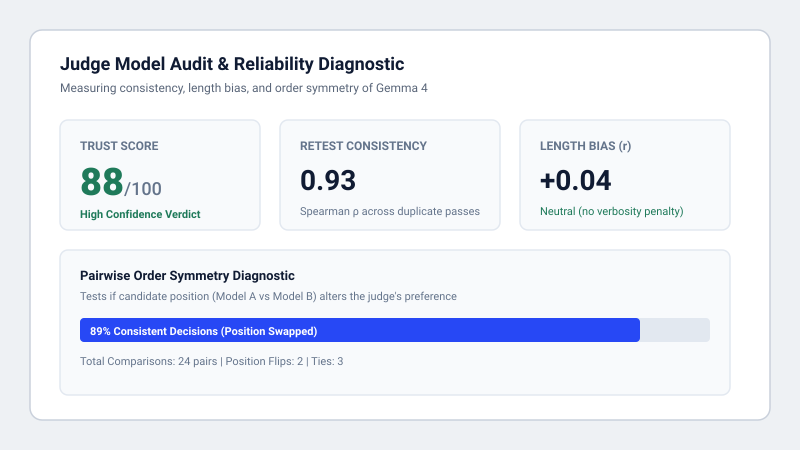

# ModelFit

> Find the smallest local model that is good enough for your prompts, and audit the judge that picked it.



---

## 1. The Problem

People pick local models by guesswork and trust LLM judges without checking them. When running models on laptops or edge devices, teams either over-provision large models that exhaust RAM or blindly pick small models that fail silently on their domain prompts.

---

## 2. What It Does

**The Recommender**
ModelFit evaluates your candidate models against custom domain prompts and determines the exact "good enough" local model. By balancing quality, generation throughput (tokens/second), and RAM/VRAM footprint against user-tunable thresholds, it identifies the smallest model that meets your performance bar without wasteful overhead.

**The Pareto Frontier**
An interactive trade-off visualization maps quality against memory and latency. Users can interactively adjust quality thresholds and trade-off weightings across Quality, Speed, and Memory to watch the recommended "Good Enough" pick adapt in real-time, accompanied by 95% bootstrap confidence intervals.

**The Judge Audit**
Rather than taking LLM evaluations on faith, ModelFit audits the judge model itself. It measures retest consistency across repeated passes (Spearman rho and Mean Absolute Difference), checks for length bias (Pearson correlation between response length and score), and runs pairwise position swaps to expose order bias, compiling these diagnostics into an overall Judge Trust Score.

---

## 3. How It Works

```text
┌─────────────────┐       ┌─────────────────┐       ┌─────────────────┐       ┌─────────────────┐
│   1. GENERATE   │ ────> │    2. JUDGE     │ ────> │    3. AUDIT     │ ────> │  4. RECOMMEND   │
│                 │       │                 │       │                 │       │                 │
│ Test prompts on │       │ Gemma 4 scores  │       │ Retest check,   │       │ Pareto frontier │
│ local candidates│       │ blind outputs   │       │ length bias, &  │       │ & "Good Enough" │
│ via Ollama      │       │ on 1-5 rubric   │       │ order swap test │       │ model verdict   │
└─────────────────┘       └─────────────────┘       └─────────────────┘       └─────────────────┘
```

---

## 4. Quick Start

### Prerequisites
1. Install [Ollama](https://ollama.com/) and make sure it is running (`ollama serve`).
2. Pull the judge model and at least one candidate:
   ```powershell
   ollama pull gemma4:latest
   ollama pull llama3.2:1b
   ```
3. Copy environment configuration:
   ```powershell
   cp .env.example .env
   ```

### Run the Backend (FastAPI)
```powershell
cd backend
python -m venv .venv
.\.venv\Scripts\Activate.ps1
pip install -r requirements.txt
uvicorn app.main:app --port 8000 --reload
```

### Run the Frontend (Next.js)
```powershell
cd frontend
npm install
npm run dev
```
Open [http://localhost:3000](http://localhost:3000) in your browser.

---

## 5. Models & Cloud Options

- **Local Candidates:** Any model installed in Ollama (e.g., `llama3.2:1b`, `qwen2.5:0.5b`, `gemma2:2b`, `mistral:7b`).
- **Judge Model:** `gemma4:latest` (or `gemma4-safe:latest`) running locally via Ollama. The judge receives candidate outputs blinded (names anonymized) and evaluates relevance, correctness, and adherence to reference answers using a structured JSON schema.
- **Optional Cloud Models:** You can optionally provide a `GROQ_API_KEY` or `OPENROUTER_API_KEY` in `.env` to evaluate cloud-hosted candidate models or benchmark against cloud baselines. Only prompts explicitly selected for cloud models are transmitted externally.

---

## 6. Privacy & Offline Operation

Everything runs entirely on your local machine by default. Prompts, candidate outputs, and judging scores remain inside your local Ollama instance and local SQLite database. External network requests are only made if you explicitly configure optional Groq or OpenRouter API keys.

---

## 7. Built at Hack Day

This project was written from scratch on 17 October 2026 at Hacktoberfest Hack Day Mumbai. It builds on ideas from an earlier project, Synapse AI Arena, but shares no code.

---

## 8. Limitations

- **Prompt Set Size:** Small evaluation sets (fewer than 10 prompts) result in wider bootstrap confidence intervals.
- **Judge Subjectivity:** While audited for order and length bias, any single judge model possesses inherent architectural preferences.
- **Hardware Variability:** Throughput (tokens/second) and TTFT measurements reflect local hardware and GPU/CPU resource utilization at benchmark time.

---

## 9. Gallery

### New Run Configuration


### Judge Reliability Audit


---

## 10. License

This project is licensed under the [MIT License](LICENSE).
